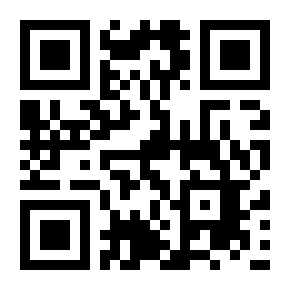

# 🍽️ 11월 25일 저녁 메뉴 추천 웹 앱

Google Apps Script(GAS)와 Google Sheets를 연결해 **저녁 메뉴에 대한 의견을 수집하는 웹 애플리케이션**입니다. 사용자가 이름, 먹고 싶은 음식, 하고 싶은 말을 입력하면 응답을 스프레드시트에 저장하고, 저장이 완료되면 **「답장 감사합니다.」** 메시지를 보여줍니다.

웹 프로그래밍 실습을 통해 HTML·CSS·JavaScript로 사용자 입력 화면을 만들고, Google Apps Script로 서버 측 데이터 저장 기능을 구현하는 과정을 익히기 위해 제작했습니다.

## 🔗 프로젝트 관련 링크

| 구분 | 링크 | 설명 |
|---|---|---|
| 🌐 배포된 웹 앱 | **[저녁 메뉴 신청하기](https://url.kr/6vg128)** | 사용자가 실제로 메뉴를 신청하는 웹 앱 |
| Google Apps Script 프로젝트 | [11월 25일 저녁 메뉴 추천](https://script.google.com/d/1XSS1hebRBLcs3dQ1ZdYr9XgamX0FcGsabM3OJFnupw6SnQzgrqZvzW2a/edit?usp=drivesdk) | `Code.gs`, `index.html`을 관리하는 프로젝트 편집 화면 |
| Google Sheets 데이터베이스 | [11월 25일 저녁 신청 받기](https://docs.google.com/spreadsheets/d/1PkdxzJzNuzwZUM-hPPhIsgfgcslXRUpc9YH1CJ1r7JY/edit?usp=drivesdk) | 제출된 메뉴 신청 내용을 저장하는 스프레드시트 |

### 📱 웹 앱 바로 접속하기

**접속 주소:** https://url.kr/6vg128

[](https://url.kr/6vg128)

위 QR코드를 휴대폰 카메라로 스캔하거나 이미지를 클릭하면 웹 앱에 접속할 수 있습니다.

> **참고:** Google Apps Script 프로젝트 편집 링크와 스프레드시트 링크는 접근 권한이 있는 계정에서만 열릴 수 있습니다. 응답자의 이름과 의견이 저장되는 스프레드시트는 공개 편집 권한을 부여하지 않는 것이 안전합니다.

## 📌 주요 기능

- **신청 양식:** 이름, 음식, 하고 싶은 말 입력
- **입력값 확인:** 필수 입력 및 글자 수 제한(이름 40자, 음식 80자, 하고 싶은 말 500자)
- **데이터 저장:** `google.script.run`으로 GAS 서버 함수를 호출하고 Google Sheets에 응답 추가
- **완료 안내:** 저장 성공 시 `답장 감사합니다.` 메시지 표시
- **오류 안내:** 저장 실패나 입력 오류 시 안내 문구 출력
- **반응형 UI:** PC와 모바일 화면에 맞춰 배치 변경

## 🛠️ 사용 기술

| 기술 | 역할 |
|---|---|
| HTML5 | 메뉴 신청 화면 구조 |
| CSS3 | 화면 디자인 및 반응형 레이아웃 |
| JavaScript | 입력값 수집, 제출 요청, 성공·실패 화면 처리 |
| Google Apps Script | 웹 앱 제공 및 서버 측 입력 검증·시트 저장 |
| Google Sheets | 신청 응답을 저장하는 데이터베이스 역할 |

## 🔄 동작 과정

1. 사용자가 웹 앱에서 **이름**, **음식**, **하고 싶은 말**을 작성합니다.
2. **신청 확인하기** 버튼을 누릅니다.
3. 클라이언트 JavaScript가 `google.script.run.saveResponse()`를 호출합니다.
4. `Code.gs`에서 입력값을 검증하고 지정한 스프레드시트의 **`시트1`** 탭에 새로운 행을 기록합니다.
5. 저장이 성공하면 신청 화면을 완료 화면으로 전환해 **「답장 감사합니다.」**를 표시합니다.

### Google Sheets 데이터 구성

| 이름 | 음식 | 하고 싶은 말 |
|---|---|---|
| (사용자 입력) | (사용자 입력) | (사용자 입력) |

## 📁 프로젝트 구조

```text
11월25일-저녁메뉴-추천/
├── Code.gs       # 웹 앱 실행 및 응답 저장
├── index.html    # 화면, CSS, 클라이언트 JavaScript
├── qr.png        # 배포된 웹 앱 접속 QR코드
└── README.md     # 프로젝트 소개 및 링크
```

## 🚀 실행 및 배포 방법

1. Google Sheets에 `이름`, `음식`, `하고 싶은 말` 헤더를 가진 시트를 준비합니다.
2. Google Apps Script 프로젝트에서 `Code.gs` 및 `index.html` 파일을 작성합니다.
3. `Code.gs`의 `CONFIG.SPREADSHEET_ID`를 실제 스프레드시트 ID로, `CONFIG.SHEET_NAME`을 실제 탭 이름으로 지정합니다.
4. **배포 → 새 배포 → 웹 앱**에서 실행 계정과 접속 권한을 설정해 배포합니다.
5. 배포 URL을 열어 양식을 제출하고, Google Sheets에 응답이 저장되는지 확인합니다.

코드를 수정한 후에는 **배포 → 배포 관리 → 새 버전**으로 배포를 업데이트해야 기존 웹 앱에 수정 사항이 적용됩니다.

## 💡 제작하면서 배운 점

이번 실습을 통해 웹페이지의 입력 양식과 서버 측 저장 기능이 서로 어떻게 연결되는지 이해할 수 있었습니다. 특히 Google Apps Script의 `saveResponse()` 함수를 통해 전달받은 정보를 검증한 후 스프레드시트에 기록하는 과정을 경험했습니다.

개발 과정에서는 스프레드시트 ID가 올바르게 입력되어 있어도 **설정 확인 조건문이 잘못 작성되면 저장 과정으로 넘어가지 못한다는 문제**를 확인했습니다. 이 오류를 수정하며 입력값 검증뿐 아니라 설정값 검사와 배포 버전 관리도 중요하다는 점을 배웠습니다.

---

**개발 형태:** 웹 프로그래밍 실습 프로젝트  
**제작일:** 2026년 11월 25일
